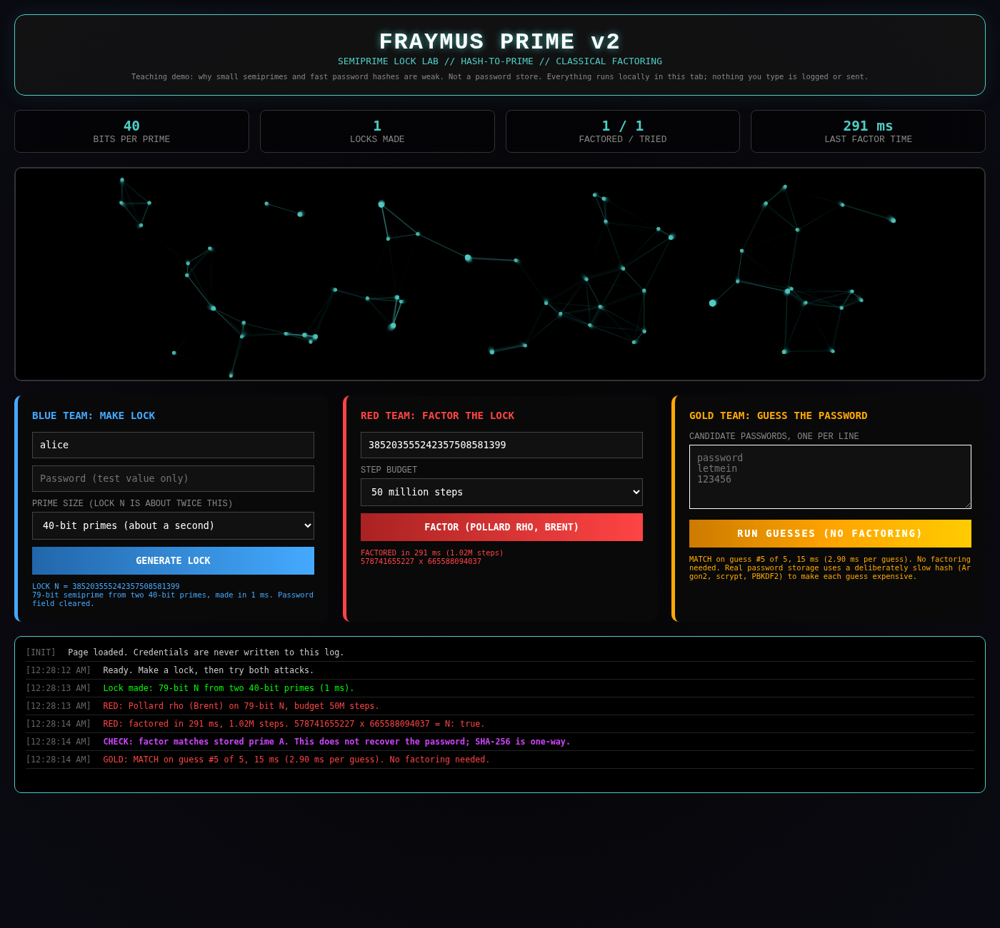

# Fraymus Prime: Semiprime Lock Lab

A single-file browser demo that turns a username and password into an RSA-style lock `N = p × q`, then attacks it two ways:

- **Red Team** factors `N` with Pollard's rho.
- **Gold Team** skips the math and guesses the password.

It is a teaching tool. It shows why small semiprimes are weak and why fast password hashing is the real problem. It is **not** a password store or an encryption scheme.

v2 rewrites `Fraymus_Sovereign_Prime.html` from [`java-memory-V1`](https://github.com/eyeoverthink/java-memory-V1/blob/main/Fraymus_Sovereign_Prime.html). The audit of v1 and the measured comparison are in [FINDINGS.md](FINDINGS.md).



## Run it

Open `index.html` in any modern browser. It has no build step, dependencies or server, and nothing leaves the tab.

1. **Blue Team: Make Lock.** Enter a username and a test password, then pick a prime size (40-bit is the default). The page derives two primes from SHA-256 of the full credentials and shows `N`. The password field is cleared.
2. **Red Team: Factor the Lock.** Runs Pollard's rho (Brent's variant) until it finds a factor or uses up the step budget. A check line confirms the factor matches one of the stored primes, and says plainly that this does *not* recover the password.
3. **Gold Team: Guess the Password.** Paste candidate passwords, one per line. Each guess rebuilds the lock and compares it to `N`. If the real password is in the list, it is found with no factoring.

## How it works

| Step | What the code does |
|---|---|
| Hash to prime | `SHA-256("fraymus-prime-v2|A|" + user + "|" + pass)`: take the top *k* bits, set the top and bottom bits, then step to the next prime. Prime B is made the same way with the `B` tag. |
| Primality | Miller-Rabin with the first 13 prime bases. This is deterministic for every n < 3.3 × 10²⁴ (about 2⁸¹), which covers every size offered. |
| Factoring | Pollard's rho with Brent's cycle detection and batched gcd (one gcd per 256 steps). Up to 16 restarts with different constants. Expected work is about √(πp/2) steps for the smaller prime p. |
| Guessing | Rebuilds `N` from each candidate and compares it. The cost per guess is just two SHA-256 calls plus two prime searches. |
| Visuals | A Rule 30 cellular automaton seeded from a SHA-256 digest, plus the neuron canvas. Decoration only. |

All math lives in `window.FP`, separate from the UI, so it can be tested directly.

## Measured results

Chrome 137, Linux VM. Reproduce with the commands under Tests below. Raw output is in [`tests/results/`](tests/results).

| | v1 (original) | v2 (this repo) |
|---|---|---|
| Locks factored, default size | 5 / 20 at ~50-bit primes (an earlier run: 1 / 20) | 20 / 20 at 40-bit; 10 / 10 at 48-bit |
| Median time to factor | 12.4 s (successful runs only) | 8 ms (32-bit), 386 ms (40-bit), 7.7 s (48-bit) |
| Failed runs | timed out after ~20–40 s each | none |
| Lock generation (median) | 62 ms | 0.4–1.8 ms |
| Password found by guessing (5 guesses) | guess #5 in 354 ms | guess #5 in 15 ms (0.18 ms per guess) |
| Password visible in log | yes | no |

## What the numbers mean

- **Lock size is the whole story for Red Team.** Each extra 8 bits of prime multiplies the work by about 16. Real RSA uses primes of 1024 bits or more. Pollard's rho can't touch those; even the best known classical algorithm (the number field sieve) can't factor 2048-bit RSA in practice.
- **Gold Team beats Red Team at every size.** The lock is a fixed function of the password, so an attacker just guesses. Real systems defend against this with deliberately slow, salted password hashes (Argon2id, scrypt, bcrypt, PBKDF2) and never store anything derived this cheaply.
- **A factor reveals a hash-derived prime, not the password.** SHA-256 can't be reversed. In v2 both primes come from the *full* password, so a recovered factor can't be used to guess half the password at a time.

## Tests

```bash
pip install playwright
python3 tests/test_v2.py                    # correctness, UI flow, benchmarks for index.html
curl -sLO https://raw.githubusercontent.com/eyeoverthink/java-memory-V1/main/Fraymus_Sovereign_Prime.html
python3 tests/bench_v1.py Fraymus_Sovereign_Prime.html 20   # same benchmark on the original
```

The tests use `google-chrome` or `chromium` from your PATH. Set `CHROME=/path/to/browser` to pick another, or `CDP_URL=http://host:port` to attach to a running Chrome. If neither is found, run `playwright install chromium` first.

`test_v2.py` checks:
- Miller-Rabin against a Python reference on 3,010 numbers, including Carmichael numbers and strong pseudoprimes.
- Rule 30 against a Python reference.
- That every generated prime has the right bit length and is really prime.
- The full UI flow: no credential text anywhere on the page, the password field cleared, and the factor and guess results.
- Factoring success rate and timing at 32, 40 and 48-bit primes.

## Files

```
index.html            the app (v2)
FINDINGS.md           audit of v1 and what changed
tests/test_v2.py      v2 correctness + UI + benchmark
tests/bench_v1.py     benchmark of the original v1 page
tests/_browser.py     shared Playwright launcher
tests/results/        raw output from the runs quoted above
docs/screenshot.png   written by test_v2.py
```

## Credits

Concept, Blue/Red/Purple team framing and visual design: Vaughn D. Scott (EYEOVERTHINK®), from the Fraymus project. v2 rewrite, tests and audit: Devin.

No license has been chosen yet, so all rights are reserved by the author.
